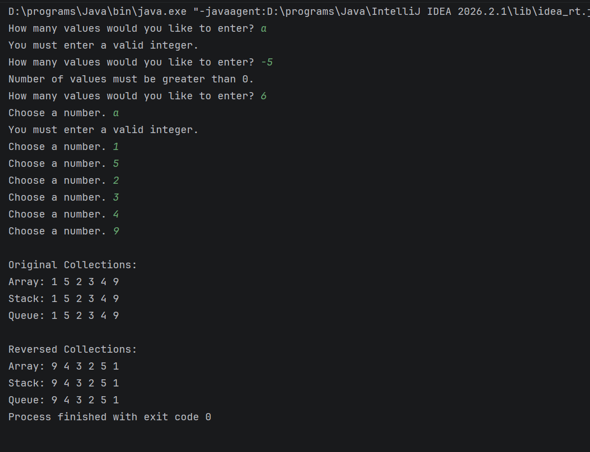

# Reversing Array
## Description
This is a Java program that takes in numbers, puts them into an array, a stack, and a queue and reverses them.

## How to Run

1. Download or clone the repository.
2. Open the project in IntelliJ IDEA or another Java IDE.
3. Open Main.java and run the program.
4. Enter how many numbers you would like to use.
5. Enter each number when prompted.
6. The program will display the original and reversed values for the array, stack, and queue.

## Screenshot
